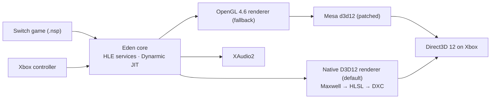

<!--
SPDX-FileCopyrightText: Copyright 2025 Eden Emulator Project
SPDX-FileCopyrightText: 2018 yuzu Emulator Project
SPDX-License-Identifier: GPL-3.0-or-later
-->

<p align="center">
  
</p>

<h1 align="center">NXbox</h1>

<p align="center">
  <b>A Switch emulator that runs natively on an Xbox Series X.</b><br>
  A port of <a href="https://git.eden-emu.dev/eden-emu/eden">Eden</a> to the Xbox UWP sandbox: the Switch's ARM64 code runs
  through a JIT, and its graphics go straight to Direct3D 12 through a native renderer written for the console, with
  OpenGL on Mesa kept as a fallback.<br>
  <a href="https://github.com/NspxMiguel/NXbox/releases/latest"><b>Download the latest release</b></a> ·
  <a href="https://discord.gg/2SxEDzVyJM"><b>Join the Discord</b></a>
</p>

<p align="center">
  <a href="LICENSE.txt"></a>
  
  
  <a href="https://github.com/NspxMiguel/NXbox/actions/workflows/build-nxbox.yml"></a>
  <a href="https://github.com/NspxMiguel/NXbox/actions/workflows/port-tests.yml"></a>
</p>

> [!IMPORTANT]
> **NXbox is paused from October 24, 2026.** The project is being archived indefinitely for financial reasons: building an emulator this way depends on a paid AI subscription that I can no longer afford, and it ends on October 25. Thank you to everyone who tested on their own console and sent logs and reports. Until then I'll try to get the games you've asked for so far working and bug-free, so that work is valued, not thrown away. If you want to carry the project on, reach me on [Discord](https://discord.gg/2SxEDzVyJM) or at miguel@nspx.dev and I'll add you as an editor. When I've saved a little money, I'll be back. Meanwhile I'll focus on school; if all goes well and I pass the year, I expect to pick NXbox back up at the end of 2026. I'm not expecting donations: this was always a hobby, and sadly it had to be paused. I also can't promise great performance in games.
>
> *The project is paused, its legacy preserved. Not a dream abandoned, just a future postponed.*

<p align="center">
  <a href="#where-it-stands">Status</a> ·
  <a href="#what-to-expect">What to expect</a> ·
  <a href="#how-it-works">How it works</a> ·
  <a href="#trying-it">Trying it</a> ·
  <a href="#development">Development</a> ·
  <a href="#credits-and-lineage">Credits</a> ·
  <a href="docs/TRANSLATING.md">Translations</a> ·
  <a href="docs/MAINTENANCE.md">Maintenance map</a> ·
  <a href="docs/nxbox-port.md">Port notes</a>
</p>

<!-- Donation address: change it here and in "Support the project" only. -->
<p align="center">
  <a href="#support-the-project"></a><br>
  <sub><code>bc1qm64el0gp0kvk7zqhl89x0vkngu2skqxd26vpjg</code></sub>
</p>

<p align="center"><sub>NXbox ships no games, firmware or keys. Bring your own, dumped from a console you own.</sub></p>

> **Experimental. No game is 100% playable without bugs yet.** Super Mario 3D World, Breath of the
> Wild and Persona 5 Royal reach gameplay on a console in Developer Mode, but running is not the same
> as working well: each has open bugs (see the [compatibility table](#compatibility)). Signed builds are on the
> [releases page](https://github.com/NspxMiguel/NXbox/releases), and NXbox updates itself from there.

> **Native Direct3D 12 renderer, on by default.** Switch shaders are translated to HLSL and compiled
> with Microsoft's DXC, with no OpenGL or Mesa in between. Super Mario 3D World plays level 1-1 lit at
> about 59 FPS on a Series X. The older OpenGL-on-Mesa path stays available as a fallback
> (`renderer_backend=0` in `LocalState\eden_settings.txt`). Plan and progress:
> [docs/d3d12-backend.md](docs/d3d12-backend.md).

## What NXbox adds

Eden is the emulator; NXbox is everything it takes to use it on an Xbox, built for a controller and a TV.

<table>
  <tr>
    <td width="50%"></td>
    <td width="50%"></td>
  </tr>
  <tr>
    <td align="center"><sub>The library, on an Xbox Series X</sub></td>
    <td align="center"><sub>Super Mario 3D World on the native Direct3D 12 renderer</sub></td>
  </tr>
  <tr>
    <td></td>
    <td></td>
  </tr>
  <tr>
    <td align="center"><sub>Moru, the built-in character creator</sub></td>
    <td align="center"><sub>Setup: confirm with A or with B</sub></td>
  </tr>
</table>

<sub>Screenshots taken on a retail Xbox Series X. Game artwork belongs to its owners.</sub>


- **A console-style game library** with cover art, a first-run setup, and per-game settings.
- **Xbox controller first:** the system font shows Xbox button icons in games that use it, and setup
  lets you choose whether A or B confirms.
- **Mods from GameBanana** installed with one button and turned off with another, and **cheats** from
  the community database (see [credits](#credits-and-lineage)).
- **Characters:** Moru, a built-in character creator, and the system's own Mii creator.
- **Shader caches shared over the LAN**, so a second console does not compile them again.
- **[NxbHelper](tools/nxbox-pack/README.md)** checks and prepares the USB drive (keys, firmware, games)
  and sends games to the console over the Device Portal. It runs on Windows, macOS and Linux.
- **Updates itself** from the releases page.

## Where it stands

Everything below was measured on a retail Xbox Series X in Developer Mode.

| Area | State |
| --- | --- |
| CPU | Switch ARM64 code runs through the Dynarmic JIT inside the UWP sandbox, with a 128 MiB code cache |
| Graphics (fallback) | OpenGL 4.6 on Direct3D 12 through a patched Mesa `d3d12` driver, built in CI |
| Graphics (default) | Native Direct3D 12 renderer: Switch shaders go Maxwell → IR → HLSL → DXC → DXIL. Super Mario 3D World plays level 1-1 lit at ~59 FPS on a Series X; BotW renders the Shrine of Resurrection at ~12 FPS. MSAA, async fences and recyclable buffer heaps are in; renderer errors are logged and the game keeps running, and a failed D3D12 start falls back to OpenGL. All 4,511 corpus shaders compile with DXC; tessellation is still limited |
| Frame pacing | OpenGL path: 60 FPS in Super Mario 3D World's hub, 30 FPS in Persona 5 Royal, about 12 FPS in Breath of the Wild, bound by the OpenGL/Mesa translation on the GPU thread (`NXBOX_THREAD_PROFILE=1` shows the ARM cores mostly idle). Loads still freeze the picture for a few seconds |
| Shaders | Per-title pipeline cache, precompiled at boot so scene changes do not compile shaders. A cache can be shared between consoles over the LAN |
| Memory | Guest memory is committed on demand. Persona 5 Royal peaks around 4.0 GB and Breath of the Wild around 4.5 GB of the 5 GiB app budget |
| Audio | XAudio2 output |
| Movies | Decoded on the CPU with FFmpeg |
| Textures | ASTC decoded on the CPU; small compressed texture arrays are decoded on the CPU on Xbox, where sampling them natively reads the wrong rows |
| Input | Xbox controller, mapped to the standard gamepad layout |
| Accounts | A default offline NXbox profile is created on first boot; firmware dumped from your own console can be installed from `LocalState\firmware` |
| Compatibility | No game is playable without bugs yet: see the [compatibility table](#compatibility) |

<details>
<summary><b>The hard parts so far</b>, each found on the console</summary>

- **Black screen for weeks**: Mesa's D3D12 driver began a pipeline-statistics query twice, so every
  command list failed to close and no GPU work ever ran. A known-color readback self-test exposed it.
- **Out of memory at 5 GiB**: the kernel zeroed guest memory with `memset`, committing the whole heap.
  On Xbox it now decommits pages instead.
- **Stutter at every scene change**: shaders compiled on first use. The pipeline cache is now
  precompiled on the renderer's own context, because a second GL context cannot be created on Mesa
  under UWP.
- **System starvation**: FFmpeg's default thread count starved the console's own services until the
  Device Portal stopped answering. It is now capped.

Written up in the [port notes](docs/nxbox-port.md).

</details>

## What to expect

- **Releases are experimental.** The [releases page](https://github.com/NspxMiguel/NXbox/releases)
  has signed builds to try; nothing is promised until it is stable.
- **No game is playable yet.** The table below is the honest state of each target.
- **Current focus: Super Mario 3D World, then The Legend of Zelda: Breath of the Wild**, and the new
  native Direct3D 12 renderer that both will move to. Mario Kart 8 Deluxe and Bayonetta come after.
- **Where it stands:** Super Mario 3D World reaches the 3D World hub at 60 FPS on the OpenGL path,
  with some views still drawing black polygons; the native Direct3D 12 renderer already draws its
  game-select screen correctly. Breath of the Wild loads a save (1.0, and 1.6 with both DLC) and runs
  in the Shrine of Resurrection at about 12 FPS; the GPU thread (OpenGL through Mesa) is the
  bottleneck, which the native renderer removes. Open bugs are
  tracked in the [issues](https://github.com/NspxMiguel/NXbox/issues).
- **How it is built:** by one person in their spare time, with AI coding tools doing much of the
  hard work on a small budget. Progress comes in bursts, and long waits are usually tool limits.
- **What you need:** an Xbox in Developer Mode, and your own game dumps, firmware and keys.
  NXbox ships none of them.
- **Community:** news, test builds and bug reports on the [NXbox Discord](https://discord.gg/2SxEDzVyJM).
- **Asking for a game:** open an issue naming the title and version you own. Games the maintainer
  can buy and test move faster.

## Compatibility

Measured on a retail Xbox Series X in Developer Mode, with copies of the games the maintainer owns.
States: **Playable** (start to finish without graphical or stability problems), **In-game**
(gameplay runs, with bugs), **Menus** (reaches menus or a hub), **Boots**, **Not tested**.
Estimates are the maintainer's guess, not a promise; they move as bugs are found.

| Game | State | What happens today | Playable estimate |
| --- | --- | --- | --- |
| Super Mario 3D World + Bowser's Fury | **In-game** | On the native D3D12 renderer: menus, the World 1 map and level 1-1 draw lit at about 59 FPS with correct button icons. Open bugs: stutter the first time a new animation plays, and stray shadow streaks in some scenes | 2–4 weeks |
| The Legend of Zelda: Breath of the Wild (1.0, 1.6 + DLC) | **In-game** | Loads a save and runs in the Shrine of Resurrection at about 12 FPS with Link drawn correctly; some terrain is still broken. Bound by the OpenGL translation on the GPU thread, so it moves to the native renderer next | 1–3 months |
| Persona 5 Royal | **In-game** | Reaches the first playable area with audio; stutters on loads and has open bugs | 3–6 weeks |
| Mario Kart 8 Deluxe | **In-game** | With firmware dumped from the user's own console installed, it gets past the character picker and starts a Grand Prix race at up to 60 FPS on the OpenGL path; track geometry is still broken and fps drops during the race | 4–8 weeks |
| Metroid Dread | **In-game** | NXbox 1.0.3: playable as Samus at 59–60 FPS; real-time cutscenes run at about 30 FPS | — |
| The Legend of Zelda: Link's Awakening | **In-game** | NXbox 1.0.3: draws the screen (it was black before) and reaches gameplay at about 33 FPS | — |
| Mario Tennis Aces | **In-game** | NXbox 1.0.3: reaches a match with the player under control at about 25 FPS, with a ~0.5 s hitch every ~8 s | — |
| Kirby and the Forgotten Land | **In-game** | NXbox 1.0.3: reaches gameplay; 60 FPS at first, about 16 FPS in the heavier areas | — |
| Hollow Knight: Silksong | **In-game** | Opens on the first try, runs the profile screen and intro at about 60 FPS and reaches gameplay at about 44 FPS | — |
| Super Mario Odyssey | **In-game** | Opening cutscene at about 58 FPS; past the camera tutorial, Cap Kingdom gameplay runs at about 22 FPS | — |
| Super Mario Bros. Wonder | **In-game** | NXbox 1.0.4: gets through the Bowser cutscene, which ran out of memory before, and keeps playing; gameplay runs at 30 FPS (the game targets 60), with a few-second freeze when many new effects compile at once | — |
| Pokémon Legends: Arceus | **In-game** | The opening draws correctly at 30 FPS; the name keyboard works (Plus confirms) and the game reaches the Hisui beach at about 27 FPS | — |
| Pokémon Scarlet | **Boots** | NXbox 1.0.3: runs at 30 FPS but the screen stays gray | — |
| Bayonetta | Not tested | Planned after Breath of the Wild | — |

Reported by testers on Xbox Series S:

| Game | Tested by | Report |
| --- | --- | --- |
| Sonic Mania | [@rubiosofiaisabel57-oss](https://github.com/rubiosofiaisabel57-oss) (GitHub) | NXbox 1.0.3 on D3D12: runs perfectly ([#12](https://github.com/NspxMiguel/NXbox/issues/12)) |
| Mainframes | @marceloasyl (Discord) | 60 FPS for 1 h 10 min without hitches |
| Freedom Planet | @marceloasyl (Discord) | NXbox 1.0.4: fully playable at a steady 60 FPS |
| Freedom Planet 2 | @marceloasyl (Discord) | NXbox 1.0.4: holds 60 FPS but skips frames |
| Metroid Dread | @marceloasyl (Discord) | NXbox 1.0.3: 60 FPS in gameplay and about 30 in cutscenes; stutters while shaders compile, and a chase QTE runs too fast to press in time |
| Super Mario 3D World + Bowser's Fury | @nickollas1235 (Discord) | 3D World runs smoothly; Bowser's Fury at 30–40 FPS |
| Cuphead | @nickollas1235 (Discord) | Runs fine |

## How it works



- `src/eden_uwp/`: the Xbox frontend. It boots the game, owns the window and the controller, and
  writes `eden_uwp_diag.txt` with frame pacing, memory and stall attribution.
- `tools/nxbox/patch_mesa_uwp.py`: the Mesa patches, applied to a pinned
  [aerisarn/mesa-uwp](https://github.com/aerisarn/mesa-uwp) in CI.
- `src/video_core/renderer_d3d12/` and `src/shader_recompiler/backend/hlsl/`: the new native
  Direct3D 12 renderer and its HLSL shader backend.
- `tools/nxbox-pack/`: **\*New\*** NxbHelper (the folder keeps its old name), a tool for Windows, macOS and
  Linux that checks and prepares the USB drive and sends games through the Device Portal.
- `tools/shader-share/`: a small server that keeps the largest valid shader cache per title.

## Trying it

Games can use `games/Base`, `games/Updates` and `games/DLC` subfolders. Files directly in
`games/` remain supported.

**New to the Device Portal?** Follow the step-by-step [user guide](docs/guide.md) (Português e English).

You need an Xbox Series X|S in **Developer Mode** and your own dumps:

> **Series S:** NXbox is developed and tested only on a Series X. The author has no Series S, so
> compatibility, performance and memory behaviour there cannot be checked or guaranteed. Reports
> from Series S owners (with `LocalState\nxbox_crash.txt`) are welcome in the issues.

1. Download the `.appx` from the [latest release](https://github.com/NspxMiguel/NXbox/releases/latest)
   and install it through the Device Portal. It must run as a **Game**: as an App it only gets 1 GB of memory
   and games crash with `bad allocation`; as a Game it gets 5 GB. Either turn on
   `DefaultUWPContentTypeToGame` in the Device Portal's settings *before* installing, or afterwards
   in Dev Home select NXbox → **View details** and set **App type** to **Game**.
2. Put `prod.keys` and `title.keys` in the app's `LocalState\eden\keys`.
3. Put your games (`.nsp`, `.nsz` or `.xci`) in `LocalState\games` (subfolders are fine), or on a USB drive in
   `NXbox\games` (the console's internal developer storage is small, a few GB). `.nsz` files are
   converted on the console the first time the library sees them.
4. Launch NXbox from the dashboard and pick the game in the library.

**\*New\*** [NxbHelper](tools/nxbox-pack/README.md) checks and prepares the USB drive (keys, firmware,
games) and sends games over the Device Portal. It does not install NXbox itself, so step 1 above (or the
[user guide](docs/guide.md)) still comes first. Downloads for Windows, macOS and Linux are on the
[latest release](https://github.com/NspxMiguel/NXbox/releases/latest).

To go back to the OpenGL path, add the line `renderer_backend=0` to
`LocalState\eden_settings.txt` with the Device Portal's file explorer, then restart NXbox.

Two other ways to get games in are built but not yet tested on the console: **Add games** imports
games and keys from a USB drive (copy to the console, or move into `NXbox\games` to play from the
drive), and **Settings → Sources** browses and downloads from Tinfoil-format sources you add
yourself (none are included).

Details and the diagnostic switches are in the [port notes](docs/nxbox-port.md#booting-a-game-from-localstate-2026-09-25).
NXbox does not bundle games, firmware or decryption keys, and never will.

## Development

Read the [port notes](docs/nxbox-port.md) and the [UWP build setup](docs/uwp_build.md). The root
build requires CMake 3.31 or newer. The standalone memory-policy checks run without the emulator's
dependency graph:

```sh
cmake -S tests/port -B build-port-tests
cmake --build build-port-tests --config Release --parallel 2
ctest --test-dir build-port-tests -C Release --output-on-failure
```

## Support the project

<table>
  <tr>
    <td></td>
    <td>
      
      <b>Bitcoin</b><br>
      <code>bc1qm64el0gp0kvk7zqhl89x0vkngu2skqxd26vpjg</code><br><br>
      Optional. It does not buy a release date or a specific game; it only helps pay for the tools
      that do the work.
    </td>
  </tr>
</table>

## Credits and lineage

**NXbox is a fork, not an emulator written from scratch.** NXbox by NSPX. Code written for NXbox
carries an NSPX copyright line, and redistributing it requires keeping the attribution described in
[NOTICE.md](NOTICE.md).

- [Eden](https://git.eden-emu.dev/eden-emu/eden) provides the emulator.
- [juanresendiz813/eden-xbox](https://github.com/juanresendiz813/eden-xbox) provided the starting
  Xbox/UWP work, including the imported boot frontend.
- [aerisarn/mesa-uwp](https://github.com/aerisarn/mesa-uwp) provides Mesa for UWP.
- Microsoft's [DirectX Shader Compiler](https://github.com/microsoft/DirectXShaderCompiler) (DXC)
  compiles the shaders of the native Direct3D 12 renderer.
- The **yuzu** and **Sudachi** projects and their contributors built the foundations Eden derives
  from.
- **Cheats** come from the community database
  [nx-cheats-db](https://github.com/sthetix/nx-cheats-db) by sthetix, reached the way
  [CNX Updater](https://github.com/CostelaCNX/CNX-Updater) by CostelaCNX (GPL-3.0) does. CNX Updater
  is a fork of [AIO-Switch-Updater](https://github.com/HamletDuFromage/aio-switch-updater) by
  HamletDuFromage (GPL-3.0), built on Borealis by natinusala, and their feature set inspired the
  downloads and cheats of NXbox. The data is fetched at runtime and belongs to its authors; see
  [NOTICE.md](NOTICE.md).
- Third-party libraries keep their own licenses and copyright notices.

Exact source revisions are recorded in the [provenance notes](docs/nxbox-port.md#source-provenance).
NXbox is an independent fork, developed with the help of AI coding tools, and its changes are not
sent upstream. It is not affiliated with or endorsed by its upstream projects,
Nintendo, Microsoft, Atlus or SEGA. The artwork was created for NXbox.

## Legal

NXbox ships no games, firmware or keys, does not help anyone get them, and is not affiliated with
Nintendo or Microsoft. Bring your own dumps. The rules, what the app downloads at runtime, and how to
report a problem are in [LEGAL.md](LEGAL.md).
The privacy policy is in [PRIVACY.md](PRIVACY.md).

## License

GNU GPL version 3 or later; see [LICENSE.txt](LICENSE.txt). Existing source notices and third-party
licenses are kept.
